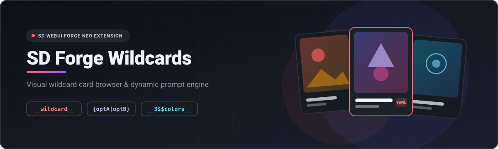

# SD Forge Wildcards

**SD Forge Wildcards** is an extension for SD WebUI Forge (Neo) that adds a visual **Wildcards** Extra Networks browser and a dynamic prompt expansion engine. Browse your wildcards as thumbnail cards, mix options with weighted or multi-pick syntax, and batch-generate card previews without leaving the UI.

---

## Key Features

- **Visual Card Browser:** Adds a **Wildcards** tab under Extra Networks with folder tree navigation, category filters, and click-to-insert tags.
- **Dynamic Prompt Engine:** Expands `__wildcard__` tags, `{optionA|optionB}` variants, `{5::cat|1::dog}` weighted choices, and `__3$$colors__` multi-item sampling across positive, negative, and hires prompts.
- **Flexible File Formats:** Supports flat or nested `.txt` lists and structured `.yaml` / `.yml` files with automatic short-key resolution.
- **Built-in Preview Manager:** Batch-generate 512px card thumbnails, shrink oversized images, collect previews for sharing, or delete unused thumbnails.

---

## Installation

### Option 1: Install via WebUI
1. Open **SD WebUI Forge (Neo)**.
2. Go to **Extensions** → **Install from URL**.
3. Paste the repository URL:
   ```text
   https://github.com/Primer0x41/sd-forge-wildcards.git
   ```
4. Click **Install**, then restart the WebUI.

### Option 2: Manual Clone
```bash
cd extensions
git clone https://github.com/Primer0x41/sd-forge-wildcards.git
```

---

## Usage & Prompt Syntax

### 1. Browse & Insert Cards
Open the **Wildcards** tab in Extra Networks (`txt2img` or `img2img`) and click any card to insert its `__wildcard__` tag into your prompt.

### 2. Dynamic Syntax Examples
| Syntax | Behavior | Example |
| :--- | :--- | :--- |
| `{a\|b\|c}` | Pick one option at random (escape literal pipes with `\|`) | `{red\|blue\|green}` |
| `{5::a\|1::b}` | Weighted random choice (`a` is 5× more likely than `b`) | `{5::cat\|1::dog}` |
| `__name__` | Pick one random entry from a wildcard file or YAML key | `__lighting/cinematic__` |
| `__N$$name__` | Pick `N` unique items separated by `, ` | `__3$$colors__` |
| `__+N$$name__` | Pick `N` items with replacement (repeats allowed) | `__+3$$colors__` |
| `__N$$sep$$name__` | Pick `N` items using a custom separator | `__3$$ / $$colors__` |

- Nested wildcards and variants inside wildcard entries expand recursively up to a safety limit (`max_depth=20`).

---

## Adding Your Own Wildcards

Place `.txt`, `.yaml`, or `.yml` files inside:
```text
extensions/sd-forge-wildcards/wildcards/
```

### Text Files (`.txt`)
One entry per line (blank lines and `#` comments are ignored):
```text
# wildcards/lighting/cinematic.txt
dramatic volumetric lighting
soft rim light, moody glow
neon reflections on wet pavement
```
Reference it with `__lighting/cinematic__`, or `__cinematic__` if the leaf name is unique across your wildcards.

### YAML Files (`.yaml` / `.yml`)
Group multiple categories in a single file (root lists are also supported):
```yaml
roles:
  fantasy:
    - brave knight in plate armor
    - mysterious elven mage
  scifi:
    - cybernetic bounty hunter
```
- Use `__roles/fantasy__` or `__roles/scifi__` for a specific group.
- Use `__roles__` to pick from all entries under `roles`.

---

## Preview Manager (`txt2img` → Scripts)

To generate or manage card thumbnails, open **Scripts** in `txt2img` and select **SD Forge Wildcards Preview Manager**:

- **Selection:** Pick individual wildcards from **Wildcards**, or enable **Use Wildcard Branch Selector** to target an entire folder branch.
- **Insertion Method:**
  - `AFTER` — Appends `__wildcard__` to your prompt.
  - `BEFORE` — Prepends `__wildcard__` to your prompt.
  - `SEARCH & REPLACE` — Replaces your placeholder text in **Search & Replace Text** with each `__wildcard__`.
- **Override Existing Previews:** Regenerate thumbnails even if a card already has a preview image.
- **Actions:**
  - `🔄 Refresh List` — Reloads wildcard files and dropdowns after disk edits.
  - `📊 Count Selected` — Displays how many wildcards match the current selection.
  - `📥 Collect Previews` — Copies matching thumbnails into `extensions/sd-forge-wildcards/COLLECTED_PREVIEWS/`.
  - `⚡ Optimize Previews` — Resizes previews larger than 512px (`.jpeg`, `.jpg`, `.png`, `.webp`) while preserving PNG/EXIF metadata. Acts on the current selection, or all previews if nothing is selected.
  - `🗑️ Delete Previews` — Removes thumbnails for the selected wildcards.

---

## Custom Card Images

- Cards without a thumbnail display the default placeholder (`resources/no-preview.jpg`).
- To use a custom image, place it under `extensions/sd-forge-wildcards/cards/` matching the wildcard's relative path and name (for example, `cards/lighting/cinematic.jpg`).
- Supported formats: `.jpeg`, `.jpg`, `.png`, `.webp`, `.gif`.

---

## Credits

- **[navimixu/wildcard-gallery](https://github.com/navimixu/wildcard-gallery)** — Original visual gallery concept.
- **[adieyal/sd-dynamic-prompts](https://github.com/adieyal/sd-dynamic-prompts)** — Inspiration for dynamic prompt syntax.
